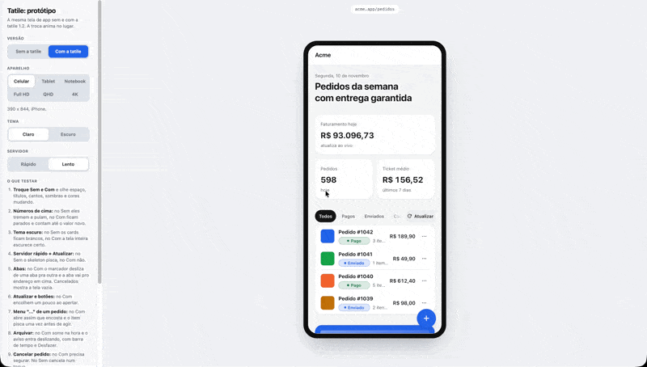

<!-- readme-padrao:header -->
<div align="center">
  
</div>

<div align="center">
  
</div>

<div align="center">

  <p><strong>Uma skill do Claude Code que ensina o agente a fazer tela que parece feita por designer.</strong></p>

  <p>
    
    
    
      
  </p>

  <p>
    <a href="#por-que-existe">Por que existe</a> •
    <a href="#o-que-faz">O que faz</a> •
    <a href="#como-funciona">Como funciona</a> •
    <a href="#stack">Stack</a> •
    <a href="#rodar-local">Rodar local</a> •
    <a href="#documentação">Documentação</a> •
    <a href="#licença">Licença</a>
  </p>
</div>

<br>

<div align="center">
  
</div>

## O que é

```yaml
produto:   skill do Claude Code com padrões de interface em módulos, cada um com regras, valores e código pronto
quem_usa:  quem constrói sistema, app ou PWA com o Claude Code e quer tela com acabamento
estado:    1.2.2, usada nos projetos do autor e evoluindo por versão
```

<!-- /readme-padrao:header -->

## Por que existe

Tela feita por IA costuma sair com a mesma cara: espaço igual em tudo, gradiente roxo, skeleton que
não bate com o conteúdo, número que treme, animação que não diz nada. Corrigir isso tela por tela,
em cada projeto, é repetir as mesmas conversas. A tatile junta essas decisões num lugar só, com os
valores e o código pronto, cada módulo testado antes de entrar. O agente lê o módulo que a tarefa toca e
aplica.

O nome vem de "tátil": a sensação de usar a interface. Pronúncia: ta-TÍ-le.

## O que faz

- **Espaçamento por tamanho de tela.** O espaço cresce de dentro pra fora (ícone, card, grade,
  margem, seção), com tokens para celular, tablet, desktop, Full HD, QHD e 4K.
- **Skeleton adaptativo.** O carregamento repete a forma que a tela tinha na última visita (quantos
  cards, menu aberto ou fechado), na web e no React Native, sem a tela pular.
- **Tipografia, forma e cor.** Escala em tokens, `tabular-nums`, raio concêntrico, sombra em
  camadas, cor por papel em claro e escuro com contraste testado, formato brasileiro de dinheiro e
  data.
- **Estados.** Carregamento que só aparece se demorar, ação otimista com Desfazer, segurar pra
  confirmar, vazio e erro com próxima ação.
- **Movimento.** Tempos e curvas por papel, modal, painel de baixo com elástico, botão que vira
  carregando, troca de ícone, lista para detalhe, tudo respeitando "reduzir movimento".
- **Formulários e navegação.** Colar liberado, erro do lado do campo, estado na URL, foco que nunca
  fica escondido, arrastar card com mouse, toque e teclado.
- **PWA nativo.** Instalar, offline, notificação e casca que parece app no celular e no desktop.
- **Auditor.** Script que lê o código do projeto e aponta valor solto, zoom travado, colar bloqueado,
  gradiente colorido, emoji na interface, hover que gruda no celular e outros sinais.

## Como funciona

```
SKILL.md                 o agente lê primeiro: módulos, ordem de aplicação, regras gerais
modulos/<nome>/README.md origem, regras numeradas com valores, como aplicar, como provar
codigo/                  tokens (CSS e TS espelhados), skeleton, estados, movimento, formato
auditor/                 node auditor/auditar.mjs <pasta-do-projeto>
```

Regras que valem em todo módulo:

1. Um valor, um lugar. Nada de número nem hex solto na tela.
2. Celular e desktop conferidos sempre, sem rolagem lateral.
3. Capacidade, não aparelho: `(hover: hover)`, `(pointer: fine)`, largura.
4. Nunca travar o zoom. Movimento reduzido respeitado.
5. Pronto é provado: o teste do módulo verde e print em 390 e 1280 px.
6. Testar também quem já usava, com o dado da versão anterior no aparelho.

## Stack

| Camada | O que usa |
|---|---|
| Regras | Markdown lido pelo Claude Code (`SKILL.md` e `modulos/`) |
| Código | CSS com custom properties, TypeScript sem dependência, hooks React |
| React Native | `react-native-web` nas demos, `AsyncStorage` ou MMKV no skeleton |

## Rodar local

Instalar como skill do Claude Code:

```bash
git clone https://github.com/leonardorejani/tatile ~/.claude/skills/tatile
```

Pronto. O Claude Code carrega a skill quando a tarefa toca tela, ou quando você cita "tatile".
Para conferir um projeto contra as regras, sem instalar nada:

```bash
node ~/.claude/skills/tatile/auditor/auditar.mjs <pasta-do-projeto>
```

Os testes, protótipos e demos que provam cada módulo ficam na cópia de desenvolvimento do autor,
fora deste repo. Onde um README de módulo cita `teste/`, é essa cópia.

## Documentação

| Doc | O que é |
|---|---|
| [`SKILL.md`](SKILL.md) | Entrada da skill: módulos, ordem, roteiro de revisão de tela |
| [`modulos/`](modulos/) | Um README por módulo, com as regras e os valores |
| [`CHANGELOG.md`](CHANGELOG.md) | O que mudou em cada versão |
| [`auditor/`](auditor/) | Script que confere o projeto e as regras dele |

## Licença

MIT. Veja o arquivo [LICENSE](LICENSE).

Créditos de fontes de terceiros: o módulo `modulos/pwa` vem do
[pwa-nativo](https://github.com/leonardocandiani/pwa-nativo) de Leonardo Candiani (MIT, com o
`LICENSE` original na pasta do módulo). A lista de sinais de "cara de IA" adapta o
[unslop](https://github.com/heydamir/unslop) de Damir Sokolovsky (CC BY 4.0). Os tempos de movimento
citam o [motion-prompt](https://github.com/showheyohtaki/motion-prompt) de Shohei Ohtaki (MIT). Os
valores de espaçamento do celular vêm de um post do Michael Filipiuk. Regras de acabamento citam
Rauno Freiberg, Emil Kowalski, Jakub Krehel, Adam Argyle, Josh Comeau e as Web Interface Guidelines
da Vercel. Cada módulo diz a fonte e a data.

<!-- readme-padrao:footer -->
<br>

---

<div align="center">
  <p><strong>Feito por <a href="https://github.com/leonardorejani">Leonardo Rejani</a></strong></p>
  <a href="https://github.com/leonardorejani">
    
  </a>
  <a href="https://instagram.com/leonardorejani">
    
  </a>
</div>

<br>

<div align="center">
  
</div>
<!-- /readme-padrao:footer -->
